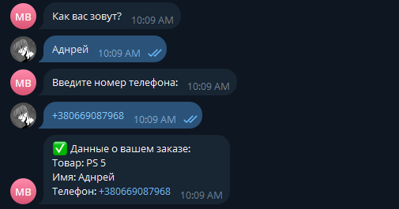
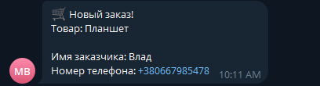

# 🛒 Market Bot

Telegram-бот интернет-магазина: каталог товаров с фото, оформление заказов и админ-панель прямо в Telegram.
Владелец магазина управляет товарами и получает заказы, не открывая ни базу данных, ни код.

## Возможности

**Для покупателей**
- 📦 Каталог товаров с фото, ценой и описанием
- ◀️ ▶️ Листание товаров кнопками
- 🛒 Оформление заказа по шагам: имя → телефон
- ✅ Проверка номера телефона: при ошибке бот попросит ввести номер заново
- ❌ Отмена в любой момент командой `/cancel`

**Для владельца (админа)**
- 🔔 Мгновенное уведомление о каждом новом заказе
- 📋 Просмотр всех заказов командой `/orders`
- ➕ Добавление товаров через бота: название, цена, описание и фото
- 🗑 Удаление товаров через бота по номеру
- 🔒 Админ-команды доступны только владельцу, для остальных пользователей они скрыты

**Надёжность**
- Изменения в каталоге видны покупателям сразу, без перезапуска бота
- Если товар удалили, пока покупатель смотрел каталог, бот не сломается: старые кнопки листания покажут актуальные товары, а заказ удалённого товара будет отклонён с понятным сообщением
- Пустой каталог обрабатывается корректно
- Проверка ввода на каждом шаге: цена и номер товара только цифрами, на шаге фото принимается только фото

## Скриншоты

| Каталог | Оформление заказа | Уведомление админу |
|---|---|---|
|  |  |  |

## Технологии

- **Python 3.12+**
- **aiogram 3**: асинхронный фреймворк для Telegram-ботов
- **SQLite + aiosqlite**: хранение товаров и заказов
- **FSM** (машина состояний aiogram): пошаговые диалоги
- **python-dotenv**: токен и ID админа вынесены в `.env`

## Структура проекта

```
├── main.py            # запуск бота
├── main_commands.py   # команды покупателя: каталог, заказ
├── admin_cm.py        # команды админа: заказы, добавление и удаление товаров
├── main_kb.py         # inline-клавиатуры
├── states.py          # состояния FSM
├── database.py        # работа с базой данных
├── seed.py            # начальное заполнение каталога
├── images/            # фото стартовых товаров
└── screenshots/       # скриншоты для README
```

## Запуск

1. Клонировать репозиторий и установить зависимости:
   ```bash
   pip install aiogram python-dotenv aiosqlite
   ```

2. Создать файл `.env` в корне проекта:
   ```
   TOKEN=токен_бота_от_BotFather
   ADMIN_ID=ваш_telegram_id
   ```

3. Заполнить каталог стартовыми товарами (один раз):
   ```bash
   python seed.py
   ```

4. Запустить бота:
   ```bash
   python main.py
   ```

## Команды

| Команда | Кто | Что делает |
|---|---|---|
| `/start` | все | приветствие |
| `/goods` | все | открыть каталог |
| `/cancel` | все | отменить текущее действие |
| `/orders` | админ | список заказов |
| `/add_product` | админ | добавить товар |
| `/delete_product` | админ | удалить товар |